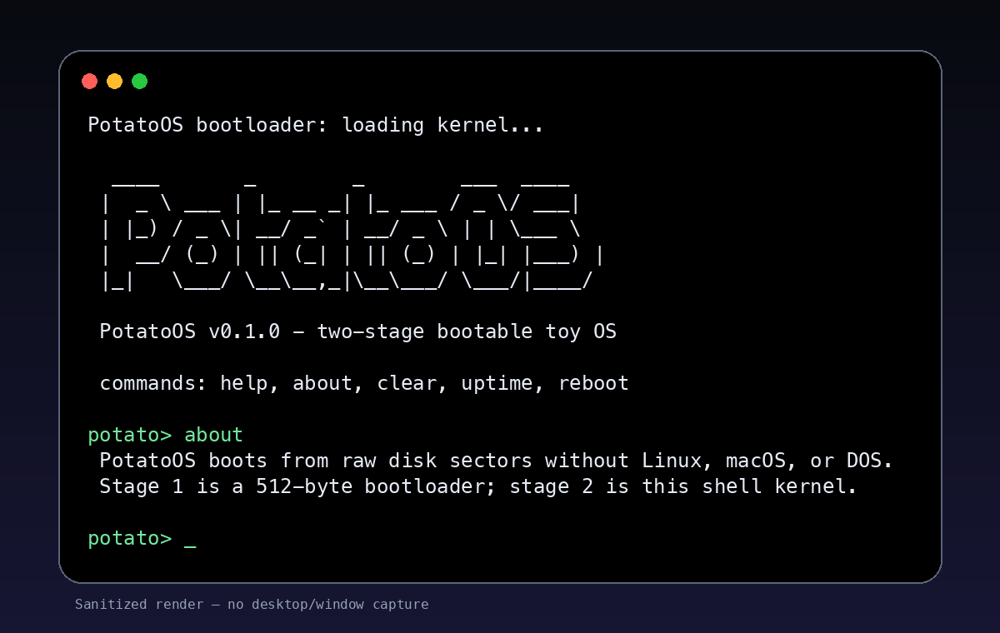

# PotatoOS 🥔

A tiny bootable toy operating system with a 512-byte BIOS bootloader and a stage-2 real-mode shell kernel.

PotatoOS is intentionally small, readable, and professional: it boots directly in an emulator, clears the screen, prints a banner, accepts keyboard input, and exposes a tiny shell.




## Features

- 512-byte stage-1 bootloader written in x86 real-mode assembly
- Stage-2 shell kernel loaded from raw disk sectors
- BIOS boot signature (`0x55AA`)
- Interactive shell prompt: `potato>`
- Commands: `help`, `about`, `clear`, `reboot`
- Verification script for boot-sector invariants
- Makefile workflow for build, verify, and run
- GitHub Actions CI

## Quick start

### Requirements

- `nasm`
- `make`
- Optional: `qemu-system-i386` to run the OS

On macOS:

```bash
brew install nasm qemu
```

### Build

```bash
make
```

This creates:

```text
build/potato-os.img
```

### Verify

```bash
make verify
```

### Run in QEMU

```bash
make run
```

You should see the PotatoOS banner and shell prompt.

## Shell commands

| Command | Description |
| --- | --- |
| `help` | Show available commands |
| `about` | Explain what PotatoOS is |
| `clear` | Clear the screen and redraw the banner |
| `uptime` | Stub for planned timer support |
| `reboot` | Reboot via BIOS interrupt `0x19` |

## Architecture

PotatoOS currently runs in 16-bit real mode. The BIOS loads the boot sector at `0x7C00`, then the boot sector configures segment registers, switches video mode, and uses BIOS interrupts for keyboard and text output.

```text
BIOS → load stage 1 at 0x7C00 → load stage 2 at 0x8000 → PotatoOS shell
```

## Roadmap

- [x] Second-stage loader
- [ ] 32-bit protected mode
- [ ] Basic interrupt descriptor table
- [ ] Timer interrupt and uptime counter
- [ ] Minimal filesystem image
- [ ] Kernel split from bootloader

## License

MIT
